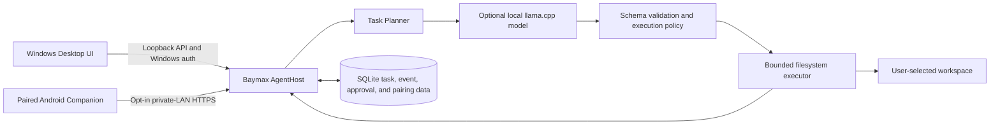

# Baymax

**A local-first Windows AI assistant for controlled workspace automation.**

Baymax turns natural-language requests into structured plans, validates those plans against a user-selected workspace, and executes supported file operations through a restricted Windows host. An optional Android companion can pair with the host over a private LAN and submit tasks when direct mobile execution is enabled.

> **Project status:** Working Windows application with optional Android pairing and task submission. Remote access is not supported. Persistent project memory, model-to-model context handoff, and checkpoint-based conversation/task recovery are proposed designs and are not implemented.

## Overview

Baymax separates language-model planning from authorization and execution:

1. A user describes a workspace task in the desktop chat.
2. An optional locally hosted model produces a structured plan.
3. Baymax validates the plan and checks permissions and workspace boundaries.
4. Desktop plans are reviewed and explicitly approved before execution.
5. A bounded filesystem executor performs permitted operations and reports results.

The model proposes actions; it does not receive unrestricted operating-system access. Baymax does not expose a general-purpose shell, arbitrary program launcher, MCP tools, or permanent file deletion.

## Features

- **Windows desktop chat** with conversation history, plan review/editing, task progress, and workspace file references.
- **Local model integration** through a llama.cpp-compatible endpoint. The model endpoint remains on loopback.
- **Structured planning** with schema validation and a constrained action catalogue.
- **Workspace boundary enforcement** with configurable Read, Write, and Execute permissions.
- **Reviewed desktop execution** using Windows-authenticated approval tied to the exact plan hash, with expiry and one-time use.
- **Bounded filesystem actions:** list and search, metadata/read, create/write, copy, move, rename, and create directories, subject to policy.
- **Optional Android pairing** using a short-lived QR invitation, Windows confirmation, device signatures, HTTPS certificate pinning, and revocation.
- **Optional direct Android task execution**, disabled by default and limited to a stricter file-action subset.
- **Task status and history** backed by SQLite, with Android polling and Desktop chat synchronization.
- **Workspace-only file suggestions and attachments** that insert references; they do not automatically upload or execute files.
- **Local-first data handling:** no cloud relay or push-notification service is part of the current task workflow.

### Not implemented

- Persistent project/task memory curated across conversations.
- Model-independent handoff between different model providers.
- Checkpoint-based task continuation after model or application interruption.
- Remote access to the Windows host.

The first three are documented design proposals, not current application features.

## Architecture



The main AgentHost API defaults to `127.0.0.1:5080`. Android connectivity is a separate, opt-in HTTPS listener bound to a selected private IPv4 address (default port `5081`). The model server remains loopback-only. The Android task route authenticates a paired device, and mobile execution must be enabled explicitly.

The proposed Persistent Memory, Task Checkpoint Manager, `TaskContextHandoffManager`, and provider-neutral Model Gateway are not part of the current architecture implementation.

## Tech Stack

### Windows

- C# and .NET 10
- WPF desktop application
- ASP.NET Core AgentHost
- SQLite persistence
- Optional llama.cpp local model server
- Windows Negotiate authentication for protected desktop operations

### Android companion

The local workspace contains an Android companion project using Java 17, Android Gradle Plugin 9, Gradle 9.6, AndroidX AppCompat, and ZXing for QR scanning. It targets Android API 35 (compile SDK 36) and requires Android API 26 or newer.

**Repository scope note:** The current `.gitignore` intentionally keeps the tracked application source Windows-only. The local `android/` project is therefore not included in a Git clone of this repository. Android build instructions below are informational for a workspace that also contains that source directory.

## Installation and Setup

### Requirements

- Windows 11
- .NET 10 SDK
- Git
- Optional: a llama.cpp-compatible server and a supported local model
- Optional for building the Android companion from a workspace containing `android/`: Android Studio/SDK and Java 17

### Build the Windows application

From the repository root in PowerShell:

```powershell
dotnet restore .\windows\Baymax.sln
dotnet build .\windows\Baymax.sln
```

### Run the desktop application

```powershell
dotnet run --project .\windows\src\Baymax.Desktop\Baymax.Desktop.csproj
```

Open **Settings**, choose an existing workspace folder, configure the optional model and permissions, then select **Save & Start Baymax**. Desktop starts and supervises its AgentHost. Do not start a second AgentHost on the same port while Desktop is managing one.

To run the AgentHost by itself instead:

```powershell
dotnet run --project .\windows\src\Baymax.AgentHost\Baymax.AgentHost.csproj
```

Check its local health endpoint:

```powershell
Invoke-RestMethod http://127.0.0.1:5080/health
```

The database is created at `%LOCALAPPDATA%\Baymax\data\baymax.db` by default. Override its location with `Baymax__DatabasePath`; override the local API port with `Baymax__Port`.

### Configure an optional local model

Baymax can connect to a llama.cpp server running on loopback. Configure model settings in Desktop **Settings**. If the server is managed by Baymax, provide the executable and model paths and verify the downloads against their publishers' provenance and checksums. The model server is not exposed to the LAN.

For environment-based configuration when running AgentHost directly, for example:

```powershell
$env:Baymax__LlamaCpp__Enabled = "true"
$env:Baymax__LlamaCpp__ManageProcess = "false"
$env:Baymax__LlamaCpp__Port = "8080"
dotnet run --project .\windows\src\Baymax.AgentHost\Baymax.AgentHost.csproj
```

This example connects to a llama.cpp server already running on `127.0.0.1:8080`; it does not start or stop that server.

### Android companion build (when its source is available)

From a workspace that includes the `android/` directory:

```powershell
$env:ANDROID_HOME = "$env:LOCALAPPDATA\Android\Sdk"
$env:ANDROID_SDK_ROOT = $env:ANDROID_HOME
.\android\gradlew.bat -p .\android assembleDebug
```

The debug APK is written to `android\app\build\outputs\apk\debug\app-debug.apk`. Android pairing is opt-in in Desktop Settings. It requires the phone and PC to be on a trusted private network, and Windows Firewall must allow the configured port on the Private profile and local subnet. Do not configure router port forwarding or expose the model server.

## Usage

### Desktop

1. Select a workspace in **Settings**.
2. Start Baymax and ensure the local model is healthy if using model-based planning.
3. Start a new chat or continue a previous conversation.
4. Enter a request in the composer. Use `@` to search workspace files or **Attach file** to insert a workspace file reference.
5. Review the generated plan, edit it if needed, and select **Approve and run**.
6. Follow task progress and results in the chat.

### Android

1. Enable Android pairing in Desktop Settings and select **Save & Start Baymax**.
2. Choose **Pair Android**, scan the short-lived QR code, and confirm the device in the Windows pairing dialog.
3. Enable direct Android task execution only if signed phone requests should execute without a separate Windows approval prompt.
4. Submit a task from the paired companion. The phone polls Windows for status and results; it does not receive push notifications.

Mobile execution remains restricted to a subset of workspace file operations. A task request is not accepted for execution when the direct mobile execution setting is disabled.

## Folder Structure

The tracked Windows application is organized as follows:

```text
.
├── .gitignore
├── LICENSE
├── README.md
└── windows/
    ├── Baymax.sln
    └── src/
        ├── Baymax.AgentHost/   # ASP.NET Core host and API
        ├── Baymax.Contracts/   # Shared request/response contracts
        ├── Baymax.Core/        # Planning, policy, persistence, execution
        └── Baymax.Desktop/     # WPF user interface
```

The local workspace may also contain `android/`, but it is excluded from the current Windows-only tracked source scope by `.gitignore`.

## Security Notes

- Run Baymax as a standard Windows user, not as Administrator.
- Keep the workspace limited to files Baymax is intended to access.
- Review every desktop plan before approval.
- Pair only devices you recognize and revoke devices that are no longer trusted.
- Enable direct Android execution only when its reduced approval flow is appropriate.
- Keep the model server loopback-only and use only trusted model/runtime downloads.
- Do not expose the AgentHost to public networks or use router port forwarding.
- Treat retrieved file contents as untrusted input; model output is still validated and policy-checked.

## License

Baymax is distributed under the MIT License. See [LICENSE](./LICENSE).

Third-party packages and model/runtime artifacts remain subject to their own licenses and terms.
